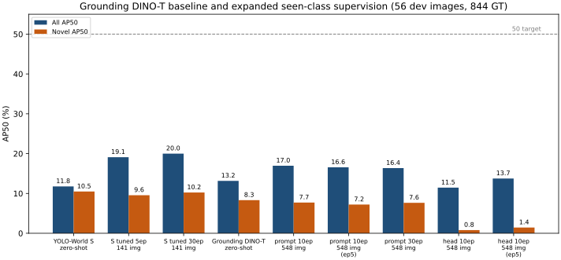

# Grounding DINO-T 基线与已见类扩样参照

本轮包含两种不同来源的实验：一是 Grounding DINO-T 零样本推理基线（不同架构），二是把已见类有监督样本从 141 张扩到 548 张的参照。本轮新增实验里最高的是 prompt 10ep，548 img（AP50=16.96%），仍低于此前的参照 S tuned 30ep，141 img（AP50=19.99%）。

## 判断与下一步

1. **换一个更强的开放词汇检测器没有解决问题。** Grounding DINO-T（1.72 亿参数）零样本 AP50 为 13.16，只比 YOLO-World S（1280 万参数）的 11.77 高 1.4 点，仍低于未适配的 YOLO-World L（16.12）和提示微调后的 S（19.99）。已见类 16.18 对 12.57 略高，未见类 8.31 对 10.48 反而更低；逐类看它只是在少数类上很强（消防栓 54.54、垃圾桶 31.68、长椅 24.02），在路灯 0.68、邮箱 0.29、自行车架 1.42、信息标牌 1.25 上几乎为零。单图 7.92 秒是 YOLO-World 0.37 秒的约 21 倍。因此"分数低是因为基座弱"这条假设没有得到支持，瓶颈更可能在输入分辨率、切片与候选排序这一侧。
2. **把已见类监督从 141 张扩到 548 张（框数 3.9 倍），在当前优化预算下没有带来提升。** 只学提示向量时，10 轮为 16.96（已见 22.74），30 轮为 16.36（已见 21.81），反而更低；逐 5 轮看第 15 轮最高（16.98），之后回落。而 141 张的 5 轮已达 19.10、30 轮 19.99。按同轮数比较（第 5 轮）也是 16.56 对 19.10。需要注意 548 张使每轮步数变成 3.9 倍，10 轮已有 5480 步，超过 141 张跑 30 轮的 4230 步，30 轮更是 16440 步，因此差距不是"训练不够"。更合理的解释是可训练容量与分辨率：提示通道只有 4096 个参数，扩样只是在同一低维空间里拟合更多图像，30 轮后已经开始过拟合（训练损失仍在下降，开发集分数回落）。
3. **头微调同时降低精度并破坏开放词汇。** head 模式 10 轮为 11.46（已见 18.12），未见类从 7.71 掉到 0.80；第 5 轮 13.75 到第 10 轮 11.46 是典型过拟合曲线。审计显示改变了 60 个检测头参数张量，且 `dfl` 分支完全没有梯度。在 548 张图上放开检测头不是当前应走的方向。
4. **唯一稳定的单类增益是消防栓**（39.76 → 47.59 / 45.94，10 轮与 30 轮都保持 +6 至 +8）。它是已见类里可用图像最少的一类（全库仅 985 张，141 张基线里每类只能取到 32 张），head 模式第 5 轮也到 57.09。但同样受样本上限约束的垃圾桶、排水口没有同步受益，长椅、井盖、接线箱反而明显下降（接线箱 28.45 → 22.04 → 12.51，随轮数持续恶化），因此只能作为单类观察，不能据此说"扩样有效"。
5. **下一步优先级。** (a) 分辨率与切片：55% 的 GT 在 960 输入下短边不足 8 像素，先解决"看得见"，再谈识别，成本需单独测。(b) 分数校准与重排序：置信度 0.001 时每张图的候选直接打满 1000 上限，说明瓶颈在排序和分类而非召回。(c) 若继续用扩样数据，应改为端到端部分解冻（例如只解冻最后阶段）并重调学习率与轮数，而不是只学 4096 维提示。(d) 以上都需在正式 validation 上复核，开发集已被反复使用。


## 关键参数

|参数|设置|
|---|---|
|Grounding DINO-T|IDEA-Research/grounding-dino-tiny，官方权重，零样本，无训练|
|检测器对照|YOLO-World v2 S，官方权重|
|每个视图输入|960×960 letterbox（两架构一致）|
|推理视图|全图＋原图1024像素切片，步长768|
|每视图 / 合并后最大输出|1000 / 1000|
|置信度 / NMS IoU|0.001 / 0.7|
|COCO maxDets|[1,10,100]|
|精度 / CUDA分配器限额|FP32 / 60%|
|开发集|同56张、844个GT，8已见＋5未见|
|扩样训练数据|548张、7601框，每类上限160张，开发图零重叠|
|扩样轮数 / 学习率|提示模式10轮与30轮两档，lr 2e-4；head 模式10轮，提示lr 2e-4＋检测头lr 1e-4|
|CPU线程 / seed|4 / 17|

## 全部结果

|实验|总体AP50|已见AP50|未见AP50|AP50:95|单图中位秒|说明|
|---|---:|---:|---:|---:|---:|---|
|yoloworld_s_zeroshot|11.77|12.57|10.48|8.08|0.369|reference, no adaptation|
|yoloworld_s_tuned5_141|19.10|25.07|9.55|12.34|0.383|previous 141-image prompt tuning|
|yoloworld_s_tuned30_141|19.99|26.09|10.24|12.65|0.378|previous best, 141-image prompt tuning|
|grounding_dino_t_zeroshot|13.16|16.18|8.31|8.36|7.922|different architecture, no training|
|seen_expand_prompt_c160_e10b_ds|16.96|22.74|7.71|10.65|0.404|expanded seen supervision, prompt mode|
|seen_expand_prompt_c160_e10b_ds@5|16.56|22.41|7.21|10.36|0.404|intermediate epoch of seen_expand_prompt_c160_e10b_ds|
|seen_expand_prompt_c160_e30_ds|16.36|21.81|7.64|10.23|0.337|expanded seen supervision, prompt mode|
|seen_expand_prompt_c160_e30_ds@5|16.56|22.41|7.21|10.36|0.385|intermediate epoch of seen_expand_prompt_c160_e30_ds|
|seen_expand_prompt_c160_e30_ds@10|16.96|22.74|7.71|10.65|0.345|intermediate epoch of seen_expand_prompt_c160_e30_ds|
|seen_expand_prompt_c160_e30_ds@15|16.98|22.84|7.59|10.60|0.335|intermediate epoch of seen_expand_prompt_c160_e30_ds|
|seen_expand_prompt_c160_e30_ds@20|16.58|22.16|7.65|10.35|0.336|intermediate epoch of seen_expand_prompt_c160_e30_ds|
|seen_expand_prompt_c160_e30_ds@25|16.84|22.47|7.82|10.62|0.337|intermediate epoch of seen_expand_prompt_c160_e30_ds|
|seen_expand_head_c160_e10_ds|11.46|18.12|0.80|6.77|0.409|expanded seen supervision, head mode|
|seen_expand_head_c160_e10_ds@5|13.75|21.44|1.44|7.84|0.408|intermediate epoch of seen_expand_head_c160_e10_ds|



## 逐类别 AP50

|类别|S tuned 30ep 141 img|Grounding DINO-T zero-shot|prompt 10ep 548 img|prompt 30ep 548 img|head 10ep 548 img|
|---|---:|---:|---:|---:|---:|
|object--street-light|30.44|0.68|29.36|31.98|32.73|
|object--junction-box|28.45|3.94|22.04|12.51|8.63|
|object--trash-can|42.53|31.68|39.97|38.85|32.74|
|object--fire-hydrant|39.76|54.54|47.59|45.94|48.79|
|object--manhole|20.95|13.63|11.07|12.15|7.10|
|object--catch-basin|9.14|6.28|2.85|3.07|0.60|
|object--support--utility-pole|17.62|8.67|15.86|16.21|8.04|
|object--sign--store|19.82|10.04|13.19|13.77|6.34|
|object--cctv-camera|1.19|14.58|1.98|1.62|0.03|
|object--bench|39.61|24.02|30.73|30.50|3.95|
|object--mailbox|0.39|0.29|0.27|0.30|0.00|
|object--bike-rack|5.61|1.42|1.32|1.37|0.00|
|object--sign--information|4.40|1.25|4.25|4.43|0.00|

## 验证与局限

- 两个实验使用同一开发图清单、同一 COCO 真值、同一推理几何（960 letterbox、1024 切片、步长 768、conf 0.001、NMS 0.7）。
- Grounding DINO-T 是零样本基线，不接收任何本任务标注；它的分数说明的是换一个架构能把整体 AP50 推到哪里，不是统一口径的 SOTA 对比（官方 COCO 分数不能外推）。
- 扩样参照只加大已见类样本量，未见类仍完全隔离；它用于判断充分监督下已见类能到多少，不能当作开放词汇成果。
- 开发集已参与连续实验决策，存在选择偏差；正式 validation 未使用。
- 548 张训练图里 505 张含路灯，这是 Vistas 标注分布造成的，不是采样错误；因此扩样对路灯提升的贡献不能外推成所有设施类都同样受益。
- 扩样实验只跑了单 seed，学习率与轮数未调参，30 轮没有学习率衰减或早停，末轮并非最优轮次；head 模式只跑到 10 轮。
- 置信度 0.001 时两个架构都把每张图的候选打满 1000 条上限（GDINO 共 56000 条 = 1000×56），即候选饱和，分数反映的是排序质量。
- 训练用整图 letterbox 到 960，评测用全图＋1024 切片，训练与评测的尺度不完全一致；这是沿用历史设置以保持与既有结果可比。

## 复现命令

```powershell
powershell -ExecutionPolicy Bypass -File scripts\Start-GdinoEval_ds.ps1 -Workspace E:\CodexWorkspace\StreetObject_DataPlan
powershell -ExecutionPolicy Bypass -File scripts\Start-SeenExpand_ds.ps1 -Workspace E:\CodexWorkspace\StreetObject_DataPlan -Mode prompt -Epochs 10 -TrainPerClass 160
powershell -ExecutionPolicy Bypass -File scripts\Start-SeenExpand_ds.ps1 -Workspace E:\CodexWorkspace\StreetObject_DataPlan -Mode prompt -Epochs 30 -TrainPerClass 160
powershell -ExecutionPolicy Bypass -File scripts\Start-SeenExpand_ds.ps1 -Workspace E:\CodexWorkspace\StreetObject_DataPlan -Mode head -Epochs 10 -TrainPerClass 160
```

完整逐类、逐轮与逐参数记录见仓库内 `results/gdino-seen-expand-20261117_ds.json`；本轮新增文件与踩坑记录见 [`ds-experiment-changes.md`](ds-experiment-changes.md)。