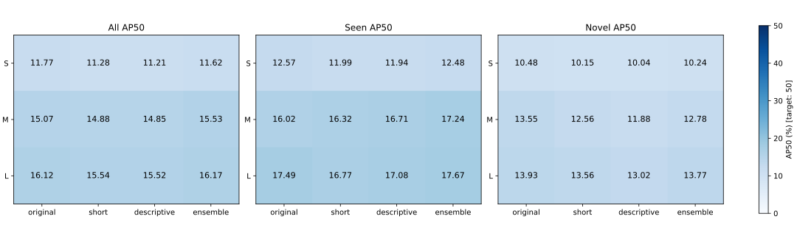

# 固定全图＋切片的提示词与模型规模对照

本轮完成12组预训练推理对照（S/M/L × 四种提示）及2组S微调参照。预训练组开发集最高为l_ensemble，总体AP50=16.17%；全部组最高为s_tuned30，AP50=19.99%。本轮没有新增训练。

## 判断与下一步

**本轮未达到50% AP50目标；应把主精力转向不同检测架构和有监督适配诊断，不再把继续扩展同类词语或单纯增大YOLO-World作为主要路线。** 这不是证明YOLO-World能力上限，而是当前数据和已测设置下的实验决策。

- 同提示的模型规模收益存在：original从S 11.77到M 15.07、L 16.12；S→L增加4.35个AP50点。参数量由12.76M到46.83M，单图中位耗时由0.37到0.88秒。成本增加明显，效果仍不足。
- 已测提示改写收益很小：简短名、描述性文本在S/M/L都未超过各自original；嵌入平均在M增加0.46点，在L仅增加0.05点，在S略降。不能把0.05点视为可靠优势，也不能据此否定所有可能的prompt设计。
- 监督适配仍有价值：复用S的30轮提示权重再用全图+切片，AP50为19.99，已见26.09、未见10.24；5轮参照为19.10、25.07、9.55。提高epoch有小收益，但继续只延长prompt-only训练缺乏足够依据。
- 未见类并未被解决。L original未见AP50为13.93，是本轮最高；最高总体组合与最高未见组合不同。摄像头AP50由S original 2.47到L original 10.57，邮箱仍0.26，信息标牌2.04。不能用个别容易类别的高分代表整体开放词汇能力。
- 类别差异比平均值更值得关注：L original消防栓60.55、长椅54.72，但接线箱与排水口都为0；S tuned30接线箱28.45、排水口9.14、灯具30.44。这说明适配方式与类别域差异仍然重要，单纯模型规模不能替代任务学习。

下一轮建议按以下顺序执行（本轮未执行）：

|顺序|实验|要判断的核心问题|
|---|---|---|
|1|增加Grounding DINO-T不同架构基线，保留全图+切片、类别和开发真值，按模型要求明确记录预处理与词语到类别映射|低分是否主要与YOLO-World基座有关|
|2|扩大已见类训练样本并建立充分监督的已见类检测参照，保留未见类别隔离|当前数据和标注定义下，充分适配能否明显提高已见AP50|
|3|依据前两项结果选择基座，比较prompt-only与prompt+框回归分支；必要时再加入有限视觉适配和教师约束|如何在获得设施检测收益时控制未见类别退化|

Grounding DINO-T有公开Swin-T权重和官方推理/评测代码，适合作为不同架构的对照；其COCO成绩不能外推为本任务成绩。[官方实现与权重](https://github.com/IDEA-Research/GroundingDINO)

充分监督参照只用于诊断，不作为开放词汇成果；本轮也没有评估M/L微调后的潜力。后续仍报告seen/novel AP50和逐类结果，不能只追求总体50%而忽视未见类。正式validation继续保留，避免把反复开发集选择当成最终性能。


## 关键参数

|参数|固定设置|
|---|---|
|模型|YOLO-World v2 S/M/L，官方预训练权重|
|本轮Epoch / 学习率|0 / 不适用（仅推理）|
|Batch size|1，各实验串行|
|每个视图输入|960×960 letterbox|
|推理视图|全图＋原图1024像素切片|
|切片步长 / 重叠|768 / 名义25%|
|提示数量|13类、每类1个向量；ensemble为向量平均|
|置信度 / NMS IoU|0.001 / 0.7|
|每个视图 / 合并后最大输出|1000 / 1000|
|COCO maxDets|[1,10,100]，各组一致|
|精度 / CUDA分配器限额|FP32 / 60%|
|开发集|同56张、844个GT，8已见＋5未见|
|CPU线程 / seed|4 / 17|
|固定可视化|4张全图＋每类1局部，显示阈值0.1|

S tuned5/tuned30复用此前训练出的提示向量：141张训练图、5/30轮、batch1、lr0.0002、960输入、4096个提示参数、网络冻结；不能与未适配M/L直接解释成纯参数量差异。S/M/L同提示对照属于已发布checkpoint的规模对照，未重新控制各模型预训练过程。

## 全部结果

|模型/提示|总体AP50|已见AP50|未见AP50|AP50:95|单图中位秒|峰值allocated MiB|峰值reserved MiB|
|---|---:|---:|---:|---:|---:|---:|---:|
|s_original|11.77|12.57|10.48|8.08|0.369|181.6|692.0|
|s_short|11.28|11.99|10.15|7.90|0.378|181.6|692.0|
|s_descriptive|11.21|11.94|10.04|7.88|0.377|181.6|692.0|
|s_ensemble|11.62|12.48|10.24|8.07|0.376|181.6|1322.0|
|m_original|15.07|16.02|13.55|10.41|0.603|300.2|736.0|
|m_short|14.88|16.32|12.56|10.57|0.609|300.2|736.0|
|m_descriptive|14.85|16.71|11.88|10.26|0.603|300.2|736.0|
|m_ensemble|15.53|17.24|12.78|10.73|0.603|302.3|1360.0|
|l_original|16.12|17.49|13.93|11.40|0.877|447.1|822.0|
|l_short|15.54|16.77|13.56|11.15|0.863|447.1|822.0|
|l_descriptive|15.52|17.08|13.02|10.86|0.862|447.1|822.0|
|l_ensemble|16.17|17.67|13.77|11.47|0.906|454.9|1458.0|
|s_tuned5|19.10|25.07|9.55|12.34|0.383|181.6|692.0|
|s_tuned30|19.99|26.09|10.24|12.65|0.378|181.6|692.0|



计时为全图读取、预处理、全部视图推理和合并后处理，不含模型加载、文本编码、COCO汇总和可视化；排除首图。显存为模型加载后重置计数的PyTorch峰值，不是整张GPU占用。

## 单因素比较

|固定提示|M−S总体AP50点|L−S总体AP50点|M−S未见AP50点|L−S未见AP50点|
|---|---:|---:|---:|---:|
|original|3.30|4.35|3.06|3.45|
|short|3.59|4.25|2.42|3.42|
|descriptive|3.64|4.31|1.84|2.98|
|ensemble|3.91|4.56|2.54|3.54|

|固定模型|short−original AP50点|descriptive−original AP50点|ensemble−original AP50点|
|---|---:|---:|---:|
|S|-0.48|-0.56|-0.15|
|M|-0.19|-0.22|0.46|
|L|-0.58|-0.60|0.05|

## 逐类别AP50

|类别|S original|M original|L original|预训练最高组合 l_ensemble|S tuned5|S tuned30|
|---|---:|---:|---:|---:|---:|---:|
|object--street-light|0.59|2.17|2.27|1.30|27.11|30.44|
|object--junction-box|0.00|0.00|0.00|0.00|26.69|28.45|
|object--trash-can|41.93|43.40|46.26|43.44|45.07|42.53|
|object--fire-hydrant|37.85|50.81|60.55|60.68|41.20|39.76|
|object--manhole|11.66|17.10|17.42|18.60|24.79|20.95|
|object--catch-basin|0.00|0.00|0.00|0.00|3.81|9.14|
|object--support--utility-pole|4.60|8.57|7.28|10.95|16.64|17.62|
|object--sign--store|3.93|6.07|6.12|6.41|15.25|19.82|
|object--cctv-camera|2.47|8.37|10.57|9.41|0.65|1.19|
|object--bench|41.38|51.22|54.72|54.70|36.87|39.61|
|object--mailbox|0.39|0.98|0.26|0.17|0.31|0.39|
|object--bike-rack|4.60|4.64|2.07|2.02|6.06|5.61|
|object--sign--information|3.57|2.51|2.04|2.57|3.88|4.40|

## 预先固定的提示词

原提示、简短类名和描述性提示如下；ensemble按类别将三种CLIP归一化向量平均后再次L2归一化，保持13个查询，不增加检测查询数量。中途没有根据分数更改提示，也没有逐类别拼装最佳结果。

|类别|original|short|descriptive|
|---|---|---|---|
|object--street-light|street light fixture|street light|street lamp lighting fixture|
|object--junction-box|electrical junction box|electrical cabinet|outdoor electrical junction box|
|object--trash-can|trash can|garbage bin|public trash bin|
|object--fire-hydrant|fire hydrant|fire hydrant|street fire hydrant|
|object--manhole|manhole cover|manhole cover|round metal manhole cover in the road|
|object--catch-basin|storm drain|storm drain grate|storm drain grate at the curb|
|object--support--utility-pole|utility pole|utility pole|utility pole carrying overhead wires|
|object--sign--store|store sign|shop sign|storefront shop sign|
|object--cctv-camera|surveillance camera|security camera|mounted surveillance camera|
|object--bench|bench|bench|outdoor public bench|
|object--mailbox|mailbox|mailbox|street mailbox for posting letters|
|object--bike-rack|bicycle rack|bike rack|metal bicycle parking rack|
|object--sign--information|information sign|information sign|public information signboard|

## 固定抽样结果

每组目录下visual_samples保存真值、S tuned5参照、本组预测，样本按固定哈希选择，不依赖效果。局部图只是显示裁剪，不是额外推理。绿色真值、黄色预测，显示阈值0.1；未显示的低置信度候选仍参与AP评测。

（固定抽样影像见本地实验目录，数据集影像不上传公开仓库。）

（固定抽样影像见本地实验目录，数据集影像不上传公开仓库。）

## 验证、局限与研究贡献

14组均使用相同开发图清单、COCO真值哈希和推理设置；S tuned5精确复现上轮AP50。官方validation未使用。这里只能称为相对本任务未进行监督适配的预训练推理，不能声称预训练从未见过这些类别。

当前开发集已用于连续实验决策，最高组合有选择偏差；部分类别GT仅10—20个，微小差异不能解释为显著提升。没有新训练，所以本轮未判断M/L的提示微调或检测头训练潜力。没有变更类别、排除困难目标或降低IoU门槛来追求50%。

本轮为研究A选择设施检测的提示策略、预训练基座及后续适配方式提供依据；不代表Logo识别、分割或地理定位已有对应提升。原始预测、影像和权重仅保留本地。

## 来源与完整参数

预训练模型：[Ultralytics官方模型说明](https://docs.ultralytics.com/models/yolo-world/)；[固定v8.3.0权重发布](https://github.com/ultralytics/assets/releases/tag/v8.3.0)。各权重SHA256和实际参数量见下方。

```json
{
  "weights": [
    {
      "size": "s",
      "filename": "yolov8s-worldv2.pt",
      "bytes": 25923032,
      "sha256": "9b2c17ab6124a913e9b3a5c170617920d91b0f01111a8479da69f00e2cf27792",
      "source": "https://github.com/ultralytics/assets/releases/download/v8.3.0/yolov8s-worldv2.pt"
    },
    {
      "size": "m",
      "filename": "yolov8m-worldv2.pt",
      "bytes": 57233192,
      "sha256": "b614d33aa35b8e61d988041ff6939dfb3ed627af88ccaf643e4cdb822eb41d71",
      "source": "https://github.com/ultralytics/assets/releases/download/v8.3.0/yolov8m-worldv2.pt"
    },
    {
      "size": "l",
      "filename": "yolov8l-worldv2.pt",
      "bytes": 94224632,
      "sha256": "276b618c2f04e6e08e32f085b3c0e8baf2dbffa46af5119b888423e859a6ee01",
      "source": "https://github.com/ultralytics/assets/releases/download/v8.3.0/yolov8l-worldv2.pt"
    }
  ],
  "fixed": {
    "image_size": 960,
    "tile_original_pixels": 1024,
    "stride": 768,
    "include_full_image": true,
    "per_view_max_det": 1000,
    "final_max_det": 1000,
    "confidence": 0.001,
    "nms_iou": 0.7,
    "batch_size": 1,
    "precision": "FP32",
    "cuda_memory_fraction": 0.6,
    "cpu_threads": 4,
    "coco_maxDets": [
      1,
      10,
      100
    ],
    "dev_images": 56,
    "epochs": 0,
    "optimizer": null,
    "seed": 17
  },
  "per_case": {
    "s_original": {
      "case": {
        "case": "s_original",
        "model": "s",
        "prompt": "original"
      },
      "fixed": {
        "image_size": 960,
        "tile_original_pixels": 1024,
        "stride": 768,
        "include_full_image": true,
        "per_view_max_det": 1000,
        "final_max_det": 1000,
        "confidence": 0.001,
        "nms_iou": 0.7,
        "batch_size": 1,
        "precision": "FP32",
        "cuda_memory_fraction": 0.6,
        "cpu_threads": 4,
        "coco_maxDets": [
          1,
          10,
          100
        ],
        "dev_images": 56,
        "epochs": 0,
        "optimizer": null,
        "seed": 17
      },
      "prompts": [
        "street light fixture",
        "electrical junction box",
        "trash can",
        "fire hydrant",
        "manhole cover",
        "storm drain",
        "utility pole",
        "store sign",
        "surveillance camera",
        "bench",
        "mailbox",
        "bicycle rack",
        "information sign"
      ],
      "embedding_rule": "original",
      "weight_sha256": "9b2c17ab6124a913e9b3a5c170617920d91b0f01111a8479da69f00e2cf27792",
      "model_parameter_count": 12759880,
      "torch": "2.5.1+cu121",
      "ultralytics": "8.3.93",
      "python": "3.11.5 | packaged by Anaconda, Inc. | (main, Sep 11 2023, 13:26:23) [MSC v.1916 64 bit (AMD64)]",
      "platform": "Windows-10-10.0.19045-SP0",
      "gpu": "NVIDIA GeForce RTX 3060 Laptop GPU",
      "script_sha256": "f7d4f06d21a8ab7339d59f1ec69ba07d2dd6ee1c81b27e582bea4bb581462027",
      "dev_list_sha256": "a0caa9158d7e187cc1728897a24fa8c1b0eee82121e20dae968463720a2bd5c7",
      "ground_truth_sha256": "f46ee29679375b7646c3a63f647d5e3582f3392ad64737d0b32740f018086bd7",
      "embedding_sha256": "54bd8a563abfa05b73e9109b20a8b96f6cdb4328e0a73d8081ba5085077241bc",
      "pretraining_caveat": "Released checkpoints vary in learned weights; this is a same-family checkpoint scale comparison, not a controlled pretraining study."
    },
    "s_short": {
      "case": {
        "case": "s_short",
        "model": "s",
        "prompt": "short"
      },
      "fixed": {
        "image_size": 960,
        "tile_original_pixels": 1024,
        "stride": 768,
        "include_full_image": true,
        "per_view_max_det": 1000,
        "final_max_det": 1000,
        "confidence": 0.001,
        "nms_iou": 0.7,
        "batch_size": 1,
        "precision": "FP32",
        "cuda_memory_fraction": 0.6,
        "cpu_threads": 4,
        "coco_maxDets": [
          1,
          10,
          100
        ],
        "dev_images": 56,
        "epochs": 0,
        "optimizer": null,
        "seed": 17
      },
      "prompts": [
        "street light",
        "electrical cabinet",
        "garbage bin",
        "fire hydrant",
        "manhole cover",
        "storm drain grate",
        "utility pole",
        "shop sign",
        "security camera",
        "bench",
        "mailbox",
        "bike rack",
        "information sign"
      ],
      "embedding_rule": "short",
      "weight_sha256": "9b2c17ab6124a913e9b3a5c170617920d91b0f01111a8479da69f00e2cf27792",
      "model_parameter_count": 12759880,
      "torch": "2.5.1+cu121",
      "ultralytics": "8.3.93",
      "python": "3.11.5 | packaged by Anaconda, Inc. | (main, Sep 11 2023, 13:26:23) [MSC v.1916 64 bit (AMD64)]",
      "platform": "Windows-10-10.0.19045-SP0",
      "gpu": "NVIDIA GeForce RTX 3060 Laptop GPU",
      "script_sha256": "f7d4f06d21a8ab7339d59f1ec69ba07d2dd6ee1c81b27e582bea4bb581462027",
      "dev_list_sha256": "a0caa9158d7e187cc1728897a24fa8c1b0eee82121e20dae968463720a2bd5c7",
      "ground_truth_sha256": "f46ee29679375b7646c3a63f647d5e3582f3392ad64737d0b32740f018086bd7",
      "embedding_sha256": "24f04285f2b702b6d09efcedb1a25a9f3fab1277e6b8a050ae4956208304dc2d",
      "pretraining_caveat": "Released checkpoints vary in learned weights; this is a same-family checkpoint scale comparison, not a controlled pretraining study."
    },
    "s_descriptive": {
      "case": {
        "case": "s_descriptive",
        "model": "s",
        "prompt": "descriptive"
      },
      "fixed": {
        "image_size": 960,
        "tile_original_pixels": 1024,
        "stride": 768,
        "include_full_image": true,
        "per_view_max_det": 1000,
        "final_max_det": 1000,
        "confidence": 0.001,
        "nms_iou": 0.7,
        "batch_size": 1,
        "precision": "FP32",
        "cuda_memory_fraction": 0.6,
        "cpu_threads": 4,
        "coco_maxDets": [
          1,
          10,
          100
        ],
        "dev_images": 56,
        "epochs": 0,
        "optimizer": null,
        "seed": 17
      },
      "prompts": [
        "street lamp lighting fixture",
        "outdoor electrical junction box",
        "public trash bin",
        "street fire hydrant",
        "round metal manhole cover in the road",
        "storm drain grate at the curb",
        "utility pole carrying overhead wires",
        "storefront shop sign",
        "mounted surveillance camera",
        "outdoor public bench",
        "street mailbox for posting letters",
        "metal bicycle parking rack",
        "public information signboard"
      ],
      "embedding_rule": "descriptive",
      "weight_sha256": "9b2c17ab6124a913e9b3a5c170617920d91b0f01111a8479da69f00e2cf27792",
      "model_parameter_count": 12759880,
      "torch": "2.5.1+cu121",
      "ultralytics": "8.3.93",
      "python": "3.11.5 | packaged by Anaconda, Inc. | (main, Sep 11 2023, 13:26:23) [MSC v.1916 64 bit (AMD64)]",
      "platform": "Windows-10-10.0.19045-SP0",
      "gpu": "NVIDIA GeForce RTX 3060 Laptop GPU",
      "script_sha256": "f7d4f06d21a8ab7339d59f1ec69ba07d2dd6ee1c81b27e582bea4bb581462027",
      "dev_list_sha256": "a0caa9158d7e187cc1728897a24fa8c1b0eee82121e20dae968463720a2bd5c7",
      "ground_truth_sha256": "f46ee29679375b7646c3a63f647d5e3582f3392ad64737d0b32740f018086bd7",
      "embedding_sha256": "d16407792c74d74f418047da96e2d9f5657654279c430d4bdbc5f010daab77c3",
      "pretraining_caveat": "Released checkpoints vary in learned weights; this is a same-family checkpoint scale comparison, not a controlled pretraining study."
    },
    "s_ensemble": {
      "case": {
        "case": "s_ensemble",
        "model": "s",
        "prompt": "ensemble"
      },
      "fixed": {
        "image_size": 960,
        "tile_original_pixels": 1024,
        "stride": 768,
        "include_full_image": true,
        "per_view_max_det": 1000,
        "final_max_det": 1000,
        "confidence": 0.001,
        "nms_iou": 0.7,
        "batch_size": 1,
        "precision": "FP32",
        "cuda_memory_fraction": 0.6,
        "cpu_threads": 4,
        "coco_maxDets": [
          1,
          10,
          100
        ],
        "dev_images": 56,
        "epochs": 0,
        "optimizer": null,
        "seed": 17
      },
      "prompts": [
        "street light fixture",
        "electrical junction box",
        "trash can",
        "fire hydrant",
        "manhole cover",
        "storm drain",
        "utility pole",
        "store sign",
        "surveillance camera",
        "bench",
        "mailbox",
        "bicycle rack",
        "information sign",
        "street light",
        "electrical cabinet",
        "garbage bin",
        "fire hydrant",
        "manhole cover",
        "storm drain grate",
        "utility pole",
        "shop sign",
        "security camera",
        "bench",
        "mailbox",
        "bike rack",
        "information sign",
        "street lamp lighting fixture",
        "outdoor electrical junction box",
        "public trash bin",
        "street fire hydrant",
        "round metal manhole cover in the road",
        "storm drain grate at the curb",
        "utility pole carrying overhead wires",
        "storefront shop sign",
        "mounted surveillance camera",
        "outdoor public bench",
        "street mailbox for posting letters",
        "metal bicycle parking rack",
        "public information signboard"
      ],
      "embedding_rule": "L2-normalized mean of the three normalized CLIP text embeddings per category; 13 queries, not 39 detections",
      "weight_sha256": "9b2c17ab6124a913e9b3a5c170617920d91b0f01111a8479da69f00e2cf27792",
      "model_parameter_count": 12759880,
      "torch": "2.5.1+cu121",
      "ultralytics": "8.3.93",
      "python": "3.11.5 | packaged by Anaconda, Inc. | (main, Sep 11 2023, 13:26:23) [MSC v.1916 64 bit (AMD64)]",
      "platform": "Windows-10-10.0.19045-SP0",
      "gpu": "NVIDIA GeForce RTX 3060 Laptop GPU",
      "script_sha256": "f7d4f06d21a8ab7339d59f1ec69ba07d2dd6ee1c81b27e582bea4bb581462027",
      "dev_list_sha256": "a0caa9158d7e187cc1728897a24fa8c1b0eee82121e20dae968463720a2bd5c7",
      "ground_truth_sha256": "f46ee29679375b7646c3a63f647d5e3582f3392ad64737d0b32740f018086bd7",
      "embedding_sha256": "1632ef7f80558886a5cd249ab60995982c404f58cf269086fe3dc3816f4c2366",
      "pretraining_caveat": "Released checkpoints vary in learned weights; this is a same-family checkpoint scale comparison, not a controlled pretraining study."
    },
    "m_original": {
      "case": {
        "case": "m_original",
        "model": "m",
        "prompt": "original"
      },
      "fixed": {
        "image_size": 960,
        "tile_original_pixels": 1024,
        "stride": 768,
        "include_full_image": true,
        "per_view_max_det": 1000,
        "final_max_det": 1000,
        "confidence": 0.001,
        "nms_iou": 0.7,
        "batch_size": 1,
        "precision": "FP32",
        "cuda_memory_fraction": 0.6,
        "cpu_threads": 4,
        "coco_maxDets": [
          1,
          10,
          100
        ],
        "dev_images": 56,
        "epochs": 0,
        "optimizer": null,
        "seed": 17
      },
      "prompts": [
        "street light fixture",
        "electrical junction box",
        "trash can",
        "fire hydrant",
        "manhole cover",
        "storm drain",
        "utility pole",
        "store sign",
        "surveillance camera",
        "bench",
        "mailbox",
        "bicycle rack",
        "information sign"
      ],
      "embedding_rule": "original",
      "weight_sha256": "b614d33aa35b8e61d988041ff6939dfb3ed627af88ccaf643e4cdb822eb41d71",
      "model_parameter_count": 28376158,
      "torch": "2.5.1+cu121",
      "ultralytics": "8.3.93",
      "python": "3.11.5 | packaged by Anaconda, Inc. | (main, Sep 11 2023, 13:26:23) [MSC v.1916 64 bit (AMD64)]",
      "platform": "Windows-10-10.0.19045-SP0",
      "gpu": "NVIDIA GeForce RTX 3060 Laptop GPU",
      "script_sha256": "f7d4f06d21a8ab7339d59f1ec69ba07d2dd6ee1c81b27e582bea4bb581462027",
      "dev_list_sha256": "a0caa9158d7e187cc1728897a24fa8c1b0eee82121e20dae968463720a2bd5c7",
      "ground_truth_sha256": "f46ee29679375b7646c3a63f647d5e3582f3392ad64737d0b32740f018086bd7",
      "embedding_sha256": "54bd8a563abfa05b73e9109b20a8b96f6cdb4328e0a73d8081ba5085077241bc",
      "pretraining_caveat": "Released checkpoints vary in learned weights; this is a same-family checkpoint scale comparison, not a controlled pretraining study."
    },
    "m_short": {
      "case": {
        "case": "m_short",
        "model": "m",
        "prompt": "short"
      },
      "fixed": {
        "image_size": 960,
        "tile_original_pixels": 1024,
        "stride": 768,
        "include_full_image": true,
        "per_view_max_det": 1000,
        "final_max_det": 1000,
        "confidence": 0.001,
        "nms_iou": 0.7,
        "batch_size": 1,
        "precision": "FP32",
        "cuda_memory_fraction": 0.6,
        "cpu_threads": 4,
        "coco_maxDets": [
          1,
          10,
          100
        ],
        "dev_images": 56,
        "epochs": 0,
        "optimizer": null,
        "seed": 17
      },
      "prompts": [
        "street light",
        "electrical cabinet",
        "garbage bin",
        "fire hydrant",
        "manhole cover",
        "storm drain grate",
        "utility pole",
        "shop sign",
        "security camera",
        "bench",
        "mailbox",
        "bike rack",
        "information sign"
      ],
      "embedding_rule": "short",
      "weight_sha256": "b614d33aa35b8e61d988041ff6939dfb3ed627af88ccaf643e4cdb822eb41d71",
      "model_parameter_count": 28376158,
      "torch": "2.5.1+cu121",
      "ultralytics": "8.3.93",
      "python": "3.11.5 | packaged by Anaconda, Inc. | (main, Sep 11 2023, 13:26:23) [MSC v.1916 64 bit (AMD64)]",
      "platform": "Windows-10-10.0.19045-SP0",
      "gpu": "NVIDIA GeForce RTX 3060 Laptop GPU",
      "script_sha256": "f7d4f06d21a8ab7339d59f1ec69ba07d2dd6ee1c81b27e582bea4bb581462027",
      "dev_list_sha256": "a0caa9158d7e187cc1728897a24fa8c1b0eee82121e20dae968463720a2bd5c7",
      "ground_truth_sha256": "f46ee29679375b7646c3a63f647d5e3582f3392ad64737d0b32740f018086bd7",
      "embedding_sha256": "24f04285f2b702b6d09efcedb1a25a9f3fab1277e6b8a050ae4956208304dc2d",
      "pretraining_caveat": "Released checkpoints vary in learned weights; this is a same-family checkpoint scale comparison, not a controlled pretraining study."
    },
    "m_descriptive": {
      "case": {
        "case": "m_descriptive",
        "model": "m",
        "prompt": "descriptive"
      },
      "fixed": {
        "image_size": 960,
        "tile_original_pixels": 1024,
        "stride": 768,
        "include_full_image": true,
        "per_view_max_det": 1000,
        "final_max_det": 1000,
        "confidence": 0.001,
        "nms_iou": 0.7,
        "batch_size": 1,
        "precision": "FP32",
        "cuda_memory_fraction": 0.6,
        "cpu_threads": 4,
        "coco_maxDets": [
          1,
          10,
          100
        ],
        "dev_images": 56,
        "epochs": 0,
        "optimizer": null,
        "seed": 17
      },
      "prompts": [
        "street lamp lighting fixture",
        "outdoor electrical junction box",
        "public trash bin",
        "street fire hydrant",
        "round metal manhole cover in the road",
        "storm drain grate at the curb",
        "utility pole carrying overhead wires",
        "storefront shop sign",
        "mounted surveillance camera",
        "outdoor public bench",
        "street mailbox for posting letters",
        "metal bicycle parking rack",
        "public information signboard"
      ],
      "embedding_rule": "descriptive",
      "weight_sha256": "b614d33aa35b8e61d988041ff6939dfb3ed627af88ccaf643e4cdb822eb41d71",
      "model_parameter_count": 28376158,
      "torch": "2.5.1+cu121",
      "ultralytics": "8.3.93",
      "python": "3.11.5 | packaged by Anaconda, Inc. | (main, Sep 11 2023, 13:26:23) [MSC v.1916 64 bit (AMD64)]",
      "platform": "Windows-10-10.0.19045-SP0",
      "gpu": "NVIDIA GeForce RTX 3060 Laptop GPU",
      "script_sha256": "f7d4f06d21a8ab7339d59f1ec69ba07d2dd6ee1c81b27e582bea4bb581462027",
      "dev_list_sha256": "a0caa9158d7e187cc1728897a24fa8c1b0eee82121e20dae968463720a2bd5c7",
      "ground_truth_sha256": "f46ee29679375b7646c3a63f647d5e3582f3392ad64737d0b32740f018086bd7",
      "embedding_sha256": "d16407792c74d74f418047da96e2d9f5657654279c430d4bdbc5f010daab77c3",
      "pretraining_caveat": "Released checkpoints vary in learned weights; this is a same-family checkpoint scale comparison, not a controlled pretraining study."
    },
    "m_ensemble": {
      "case": {
        "case": "m_ensemble",
        "model": "m",
        "prompt": "ensemble"
      },
      "fixed": {
        "image_size": 960,
        "tile_original_pixels": 1024,
        "stride": 768,
        "include_full_image": true,
        "per_view_max_det": 1000,
        "final_max_det": 1000,
        "confidence": 0.001,
        "nms_iou": 0.7,
        "batch_size": 1,
        "precision": "FP32",
        "cuda_memory_fraction": 0.6,
        "cpu_threads": 4,
        "coco_maxDets": [
          1,
          10,
          100
        ],
        "dev_images": 56,
        "epochs": 0,
        "optimizer": null,
        "seed": 17
      },
      "prompts": [
        "street light fixture",
        "electrical junction box",
        "trash can",
        "fire hydrant",
        "manhole cover",
        "storm drain",
        "utility pole",
        "store sign",
        "surveillance camera",
        "bench",
        "mailbox",
        "bicycle rack",
        "information sign",
        "street light",
        "electrical cabinet",
        "garbage bin",
        "fire hydrant",
        "manhole cover",
        "storm drain grate",
        "utility pole",
        "shop sign",
        "security camera",
        "bench",
        "mailbox",
        "bike rack",
        "information sign",
        "street lamp lighting fixture",
        "outdoor electrical junction box",
        "public trash bin",
        "street fire hydrant",
        "round metal manhole cover in the road",
        "storm drain grate at the curb",
        "utility pole carrying overhead wires",
        "storefront shop sign",
        "mounted surveillance camera",
        "outdoor public bench",
        "street mailbox for posting letters",
        "metal bicycle parking rack",
        "public information signboard"
      ],
      "embedding_rule": "L2-normalized mean of the three normalized CLIP text embeddings per category; 13 queries, not 39 detections",
      "weight_sha256": "b614d33aa35b8e61d988041ff6939dfb3ed627af88ccaf643e4cdb822eb41d71",
      "model_parameter_count": 28376158,
      "torch": "2.5.1+cu121",
      "ultralytics": "8.3.93",
      "python": "3.11.5 | packaged by Anaconda, Inc. | (main, Sep 11 2023, 13:26:23) [MSC v.1916 64 bit (AMD64)]",
      "platform": "Windows-10-10.0.19045-SP0",
      "gpu": "NVIDIA GeForce RTX 3060 Laptop GPU",
      "script_sha256": "f7d4f06d21a8ab7339d59f1ec69ba07d2dd6ee1c81b27e582bea4bb581462027",
      "dev_list_sha256": "a0caa9158d7e187cc1728897a24fa8c1b0eee82121e20dae968463720a2bd5c7",
      "ground_truth_sha256": "f46ee29679375b7646c3a63f647d5e3582f3392ad64737d0b32740f018086bd7",
      "embedding_sha256": "1632ef7f80558886a5cd249ab60995982c404f58cf269086fe3dc3816f4c2366",
      "pretraining_caveat": "Released checkpoints vary in learned weights; this is a same-family checkpoint scale comparison, not a controlled pretraining study."
    },
    "l_original": {
      "case": {
        "case": "l_original",
        "model": "l",
        "prompt": "original"
      },
      "fixed": {
        "image_size": 960,
        "tile_original_pixels": 1024,
        "stride": 768,
        "include_full_image": true,
        "per_view_max_det": 1000,
        "final_max_det": 1000,
        "confidence": 0.001,
        "nms_iou": 0.7,
        "batch_size": 1,
        "precision": "FP32",
        "cuda_memory_fraction": 0.6,
        "cpu_threads": 4,
        "coco_maxDets": [
          1,
          10,
          100
        ],
        "dev_images": 56,
        "epochs": 0,
        "optimizer": null,
        "seed": 17
      },
      "prompts": [
        "street light fixture",
        "electrical junction box",
        "trash can",
        "fire hydrant",
        "manhole cover",
        "storm drain",
        "utility pole",
        "store sign",
        "surveillance camera",
        "bench",
        "mailbox",
        "bicycle rack",
        "information sign"
      ],
      "embedding_rule": "original",
      "weight_sha256": "276b618c2f04e6e08e32f085b3c0e8baf2dbffa46af5119b888423e859a6ee01",
      "model_parameter_count": 46832050,
      "torch": "2.5.1+cu121",
      "ultralytics": "8.3.93",
      "python": "3.11.5 | packaged by Anaconda, Inc. | (main, Sep 11 2023, 13:26:23) [MSC v.1916 64 bit (AMD64)]",
      "platform": "Windows-10-10.0.19045-SP0",
      "gpu": "NVIDIA GeForce RTX 3060 Laptop GPU",
      "script_sha256": "f7d4f06d21a8ab7339d59f1ec69ba07d2dd6ee1c81b27e582bea4bb581462027",
      "dev_list_sha256": "a0caa9158d7e187cc1728897a24fa8c1b0eee82121e20dae968463720a2bd5c7",
      "ground_truth_sha256": "f46ee29679375b7646c3a63f647d5e3582f3392ad64737d0b32740f018086bd7",
      "embedding_sha256": "54bd8a563abfa05b73e9109b20a8b96f6cdb4328e0a73d8081ba5085077241bc",
      "pretraining_caveat": "Released checkpoints vary in learned weights; this is a same-family checkpoint scale comparison, not a controlled pretraining study."
    },
    "l_short": {
      "case": {
        "case": "l_short",
        "model": "l",
        "prompt": "short"
      },
      "fixed": {
        "image_size": 960,
        "tile_original_pixels": 1024,
        "stride": 768,
        "include_full_image": true,
        "per_view_max_det": 1000,
        "final_max_det": 1000,
        "confidence": 0.001,
        "nms_iou": 0.7,
        "batch_size": 1,
        "precision": "FP32",
        "cuda_memory_fraction": 0.6,
        "cpu_threads": 4,
        "coco_maxDets": [
          1,
          10,
          100
        ],
        "dev_images": 56,
        "epochs": 0,
        "optimizer": null,
        "seed": 17
      },
      "prompts": [
        "street light",
        "electrical cabinet",
        "garbage bin",
        "fire hydrant",
        "manhole cover",
        "storm drain grate",
        "utility pole",
        "shop sign",
        "security camera",
        "bench",
        "mailbox",
        "bike rack",
        "information sign"
      ],
      "embedding_rule": "short",
      "weight_sha256": "276b618c2f04e6e08e32f085b3c0e8baf2dbffa46af5119b888423e859a6ee01",
      "model_parameter_count": 46832050,
      "torch": "2.5.1+cu121",
      "ultralytics": "8.3.93",
      "python": "3.11.5 | packaged by Anaconda, Inc. | (main, Sep 11 2023, 13:26:23) [MSC v.1916 64 bit (AMD64)]",
      "platform": "Windows-10-10.0.19045-SP0",
      "gpu": "NVIDIA GeForce RTX 3060 Laptop GPU",
      "script_sha256": "f7d4f06d21a8ab7339d59f1ec69ba07d2dd6ee1c81b27e582bea4bb581462027",
      "dev_list_sha256": "a0caa9158d7e187cc1728897a24fa8c1b0eee82121e20dae968463720a2bd5c7",
      "ground_truth_sha256": "f46ee29679375b7646c3a63f647d5e3582f3392ad64737d0b32740f018086bd7",
      "embedding_sha256": "24f04285f2b702b6d09efcedb1a25a9f3fab1277e6b8a050ae4956208304dc2d",
      "pretraining_caveat": "Released checkpoints vary in learned weights; this is a same-family checkpoint scale comparison, not a controlled pretraining study."
    },
    "l_descriptive": {
      "case": {
        "case": "l_descriptive",
        "model": "l",
        "prompt": "descriptive"
      },
      "fixed": {
        "image_size": 960,
        "tile_original_pixels": 1024,
        "stride": 768,
        "include_full_image": true,
        "per_view_max_det": 1000,
        "final_max_det": 1000,
        "confidence": 0.001,
        "nms_iou": 0.7,
        "batch_size": 1,
        "precision": "FP32",
        "cuda_memory_fraction": 0.6,
        "cpu_threads": 4,
        "coco_maxDets": [
          1,
          10,
          100
        ],
        "dev_images": 56,
        "epochs": 0,
        "optimizer": null,
        "seed": 17
      },
      "prompts": [
        "street lamp lighting fixture",
        "outdoor electrical junction box",
        "public trash bin",
        "street fire hydrant",
        "round metal manhole cover in the road",
        "storm drain grate at the curb",
        "utility pole carrying overhead wires",
        "storefront shop sign",
        "mounted surveillance camera",
        "outdoor public bench",
        "street mailbox for posting letters",
        "metal bicycle parking rack",
        "public information signboard"
      ],
      "embedding_rule": "descriptive",
      "weight_sha256": "276b618c2f04e6e08e32f085b3c0e8baf2dbffa46af5119b888423e859a6ee01",
      "model_parameter_count": 46832050,
      "torch": "2.5.1+cu121",
      "ultralytics": "8.3.93",
      "python": "3.11.5 | packaged by Anaconda, Inc. | (main, Sep 11 2023, 13:26:23) [MSC v.1916 64 bit (AMD64)]",
      "platform": "Windows-10-10.0.19045-SP0",
      "gpu": "NVIDIA GeForce RTX 3060 Laptop GPU",
      "script_sha256": "f7d4f06d21a8ab7339d59f1ec69ba07d2dd6ee1c81b27e582bea4bb581462027",
      "dev_list_sha256": "a0caa9158d7e187cc1728897a24fa8c1b0eee82121e20dae968463720a2bd5c7",
      "ground_truth_sha256": "f46ee29679375b7646c3a63f647d5e3582f3392ad64737d0b32740f018086bd7",
      "embedding_sha256": "d16407792c74d74f418047da96e2d9f5657654279c430d4bdbc5f010daab77c3",
      "pretraining_caveat": "Released checkpoints vary in learned weights; this is a same-family checkpoint scale comparison, not a controlled pretraining study."
    },
    "l_ensemble": {
      "case": {
        "case": "l_ensemble",
        "model": "l",
        "prompt": "ensemble"
      },
      "fixed": {
        "image_size": 960,
        "tile_original_pixels": 1024,
        "stride": 768,
        "include_full_image": true,
        "per_view_max_det": 1000,
        "final_max_det": 1000,
        "confidence": 0.001,
        "nms_iou": 0.7,
        "batch_size": 1,
        "precision": "FP32",
        "cuda_memory_fraction": 0.6,
        "cpu_threads": 4,
        "coco_maxDets": [
          1,
          10,
          100
        ],
        "dev_images": 56,
        "epochs": 0,
        "optimizer": null,
        "seed": 17
      },
      "prompts": [
        "street light fixture",
        "electrical junction box",
        "trash can",
        "fire hydrant",
        "manhole cover",
        "storm drain",
        "utility pole",
        "store sign",
        "surveillance camera",
        "bench",
        "mailbox",
        "bicycle rack",
        "information sign",
        "street light",
        "electrical cabinet",
        "garbage bin",
        "fire hydrant",
        "manhole cover",
        "storm drain grate",
        "utility pole",
        "shop sign",
        "security camera",
        "bench",
        "mailbox",
        "bike rack",
        "information sign",
        "street lamp lighting fixture",
        "outdoor electrical junction box",
        "public trash bin",
        "street fire hydrant",
        "round metal manhole cover in the road",
        "storm drain grate at the curb",
        "utility pole carrying overhead wires",
        "storefront shop sign",
        "mounted surveillance camera",
        "outdoor public bench",
        "street mailbox for posting letters",
        "metal bicycle parking rack",
        "public information signboard"
      ],
      "embedding_rule": "L2-normalized mean of the three normalized CLIP text embeddings per category; 13 queries, not 39 detections",
      "weight_sha256": "276b618c2f04e6e08e32f085b3c0e8baf2dbffa46af5119b888423e859a6ee01",
      "model_parameter_count": 46832050,
      "torch": "2.5.1+cu121",
      "ultralytics": "8.3.93",
      "python": "3.11.5 | packaged by Anaconda, Inc. | (main, Sep 11 2023, 13:26:23) [MSC v.1916 64 bit (AMD64)]",
      "platform": "Windows-10-10.0.19045-SP0",
      "gpu": "NVIDIA GeForce RTX 3060 Laptop GPU",
      "script_sha256": "f7d4f06d21a8ab7339d59f1ec69ba07d2dd6ee1c81b27e582bea4bb581462027",
      "dev_list_sha256": "a0caa9158d7e187cc1728897a24fa8c1b0eee82121e20dae968463720a2bd5c7",
      "ground_truth_sha256": "f46ee29679375b7646c3a63f647d5e3582f3392ad64737d0b32740f018086bd7",
      "embedding_sha256": "1632ef7f80558886a5cd249ab60995982c404f58cf269086fe3dc3816f4c2366",
      "pretraining_caveat": "Released checkpoints vary in learned weights; this is a same-family checkpoint scale comparison, not a controlled pretraining study."
    },
    "s_tuned5": {
      "case": {
        "case": "s_tuned5",
        "model": "s",
        "prompt": "tuned5"
      },
      "fixed": {
        "image_size": 960,
        "tile_original_pixels": 1024,
        "stride": 768,
        "include_full_image": true,
        "per_view_max_det": 1000,
        "final_max_det": 1000,
        "confidence": 0.001,
        "nms_iou": 0.7,
        "batch_size": 1,
        "precision": "FP32",
        "cuda_memory_fraction": 0.6,
        "cpu_threads": 4,
        "coco_maxDets": [
          1,
          10,
          100
        ],
        "dev_images": 56,
        "epochs": 0,
        "optimizer": null,
        "seed": 17
      },
      "prompts": [
        "street light fixture",
        "electrical junction box",
        "trash can",
        "fire hydrant",
        "manhole cover",
        "storm drain",
        "utility pole",
        "store sign",
        "surveillance camera",
        "bench",
        "mailbox",
        "bicycle rack",
        "information sign"
      ],
      "embedding_rule": "tuned5",
      "weight_sha256": "9b2c17ab6124a913e9b3a5c170617920d91b0f01111a8479da69f00e2cf27792",
      "model_parameter_count": 12759880,
      "torch": "2.5.1+cu121",
      "ultralytics": "8.3.93",
      "python": "3.11.5 | packaged by Anaconda, Inc. | (main, Sep 11 2023, 13:26:23) [MSC v.1916 64 bit (AMD64)]",
      "platform": "Windows-10-10.0.19045-SP0",
      "gpu": "NVIDIA GeForce RTX 3060 Laptop GPU",
      "script_sha256": "f7d4f06d21a8ab7339d59f1ec69ba07d2dd6ee1c81b27e582bea4bb581462027",
      "dev_list_sha256": "a0caa9158d7e187cc1728897a24fa8c1b0eee82121e20dae968463720a2bd5c7",
      "ground_truth_sha256": "f46ee29679375b7646c3a63f647d5e3582f3392ad64737d0b32740f018086bd7",
      "embedding_sha256": "f32da1bbf03577167f689cc6cedce87d920568dff8ca60fe65d107a0f5e7f39a",
      "pretraining_caveat": "Released checkpoints vary in learned weights; this is a same-family checkpoint scale comparison, not a controlled pretraining study."
    },
    "s_tuned30": {
      "case": {
        "case": "s_tuned30",
        "model": "s",
        "prompt": "tuned30"
      },
      "fixed": {
        "image_size": 960,
        "tile_original_pixels": 1024,
        "stride": 768,
        "include_full_image": true,
        "per_view_max_det": 1000,
        "final_max_det": 1000,
        "confidence": 0.001,
        "nms_iou": 0.7,
        "batch_size": 1,
        "precision": "FP32",
        "cuda_memory_fraction": 0.6,
        "cpu_threads": 4,
        "coco_maxDets": [
          1,
          10,
          100
        ],
        "dev_images": 56,
        "epochs": 0,
        "optimizer": null,
        "seed": 17
      },
      "prompts": [
        "street light fixture",
        "electrical junction box",
        "trash can",
        "fire hydrant",
        "manhole cover",
        "storm drain",
        "utility pole",
        "store sign",
        "surveillance camera",
        "bench",
        "mailbox",
        "bicycle rack",
        "information sign"
      ],
      "embedding_rule": "tuned30",
      "weight_sha256": "9b2c17ab6124a913e9b3a5c170617920d91b0f01111a8479da69f00e2cf27792",
      "model_parameter_count": 12759880,
      "torch": "2.5.1+cu121",
      "ultralytics": "8.3.93",
      "python": "3.11.5 | packaged by Anaconda, Inc. | (main, Sep 11 2023, 13:26:23) [MSC v.1916 64 bit (AMD64)]",
      "platform": "Windows-10-10.0.19045-SP0",
      "gpu": "NVIDIA GeForce RTX 3060 Laptop GPU",
      "script_sha256": "f7d4f06d21a8ab7339d59f1ec69ba07d2dd6ee1c81b27e582bea4bb581462027",
      "dev_list_sha256": "a0caa9158d7e187cc1728897a24fa8c1b0eee82121e20dae968463720a2bd5c7",
      "ground_truth_sha256": "f46ee29679375b7646c3a63f647d5e3582f3392ad64737d0b32740f018086bd7",
      "embedding_sha256": "b5d1ce2e18ccd21aa40c71b2b55c52f27d96a939c40dab80194f0994288534a0",
      "pretraining_caveat": "Released checkpoints vary in learned weights; this is a same-family checkpoint scale comparison, not a controlled pretraining study."
    }
  }
}
```
